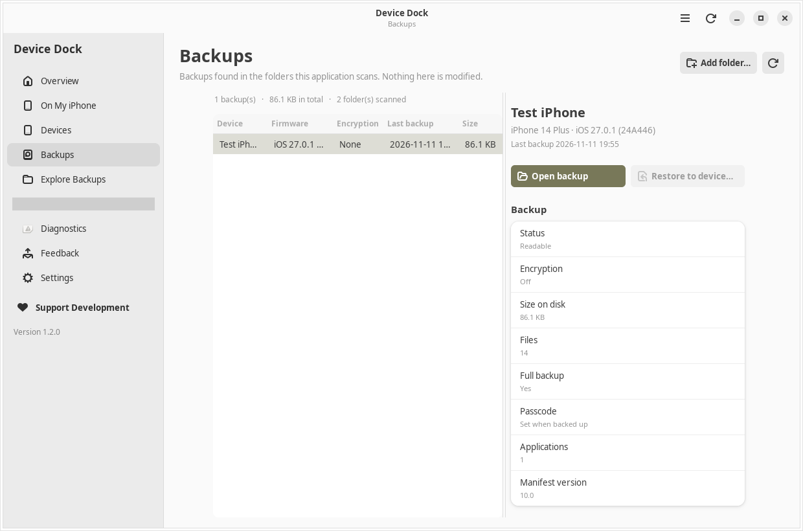

# Device Dock

**Native Linux application for managing iPhones, files and local backups.**

Device Dock is free software, licensed under the
[GNU General Public License v3.0 only](LICENSE) (GPL-3.0-only).

Device Dock discovers iPhones over usbmuxd, creates and restores backups with
`idevicebackup2`, opens encrypted backups, browses their contents, and gives read and write
access to the files on a connected phone. Everything runs locally: there is no account, no
telemetry and no cloud service.



More screenshots: [overview](docs/screenshots/overview.png),
[backup explorer](docs/screenshots/explorer.png).

## Features

| Area | What it does |
|---|---|
| **Overview** | Device status, backup counts, most recent backup, encryption mix |
| **Devices** | Live discovery through usbmuxd, device identity, backup creation, and a phone browser with preview and file transfer |
| **Backups** | Discovery across configured folders, metadata from all four plists, encrypted/plain detection, password unlock, integrity verification, HTML inventory report, restore to the matching device |
| **Explore Backups** | User-file catalog from the manifest: photos, videos, music, podcasts, books, documents and shared app data, with search, sorting, previews and export |
| **Diagnostics** | Tool availability, environment facts, log tail, copyable report |
| **Settings** | Backup locations, export folder, theme, keyring password storage, identifier masking, log level |

Backups are only read. A device is written to — file transfer, restore or factory reset —
only after an explicit confirmation.

## Requirements

* **Ubuntu 24.04** is the supported and tested platform. The `.deb` is built against it.
* GTK 4.10+ and libadwaita 1.4+; GTK 4.14 / libadwaita 1.5 are the tested versions.
* The Debian package needs **no Python**: it carries its own CPython runtime and Python
  libraries, so it is unaffected by the distribution's Python version.
* Device features need `libimobiledevice-utils`, `usbmuxd`, `ifuse` and `fuse3`; media
  playback needs the GStreamer base/good/libav plugins. The package declares all of them in
  `Depends`.

Other distributions are not tested. The source build has the same GTK/libadwaita floors,
so it is expected to work wherever those are available.

## Install

### Ubuntu 24.04 / Debian (recommended)

Download `device-dock_1.2.0_amd64.deb` and its `.sha256` from the
[releases page](https://github.com/bitsbreaches/device-dock/releases), then:

```bash
sha256sum -c device-dock_1.2.0_amd64.deb.sha256
sudo apt install ./device-dock_1.2.0_amd64.deb
device-dock            # or launch “Device Dock” from the application menu
device-dock --version
```

Upgrading from the former `apple-devices` package works the same way: the package
`Breaks`/`Replaces` the old one, so `apt` removes it and its launcher. Your settings,
cached data and backup library are moved to the new directories on first launch; backups
are never copied or deleted.

### From source

```bash
git clone https://github.com/bitsbreaches/device-dock.git
cd device-dock
python3 -m venv --system-site-packages .venv    # PyGObject comes from the system
.venv/bin/pip install -r requirements.txt
./run.sh                                        # or: .venv/bin/python -m devicedock
```

`run.sh` creates the virtual environment on first use and installs the Python dependencies.
A prefix installation provides a `device-dock` command:

```bash
PREFIX=~/.local ./packaging/install.sh
device-dock
~/.local/lib/device-dock/uninstall.sh [--purge]
```

## Build the Debian package

`packaging/build-deb.sh` produces `dist/device-dock_<version>_amd64.deb`. It compiles the
application with Nuitka in standalone mode inside the pinned Ubuntu 24.04 image from
[packaging/docker/Dockerfile](packaging/docker/Dockerfile), so the native code targets the
oldest supported glibc and no host Python is involved:

```bash
./packaging/build-deb.sh        # needs docker and network access for the pinned wheels
```

Set `DEVICE_DOCK_NATIVE_BUILD=1` to build on an Ubuntu 24.04 host that already has Nuitka
and `requirements.txt` installed. The build fails if the compiled binary cannot load its
bundled decryption engine.

The complete corresponding source for every published binary is the repository state at
the matching release tag.

## Using Device Dock

1. **Scan for backups** — the default locations (`~/Apple/MobileSync/Backup`,
   `~/Library/MobileSync/Backup`, `~/.local/share/libimobiledevice/backup`) plus any folder
   you add.
2. **Unlock** an encrypted backup with the password chosen in iTunes/Finder. The keybag is
   unwrapped in memory; enable *Settings → Security → Remember backup passwords* to keep it
   in the system keyring.
3. **Explore** the backup by user file or by data category; preview and export what you
   need.
4. **Connect a device** — unlock it, tap *Trust*, then create a backup, browse its files or
   restore a backup to it.

Device features need a running usbmuxd. The Debian package starts it during installation
when systemd is active, without restarting a running daemon and without overriding a masked
unit. Without systemd, start it once yourself:

```bash
sudo systemctl start usbmuxd
```

## Privacy and security

* **No telemetry, no accounts, no network access** during normal operation. The only
  outbound action is the optional Feedback form, which opens in your browser and is never
  submitted automatically.
* Passwords are never written to settings or logs. Keyring storage is opt-in and delegated
  to the Secret Service.
* Decrypted manifests and extracted databases live in a `0700` cache directory that is
  deleted when the vault closes and at shutdown.
* Export paths are validated against traversal; extracted content is previewed, never
  executed.
* Backups are read-only except when you explicitly restore one, after a typed confirmation
  and a full pre-flight check.

To report a vulnerability, see [SECURITY.md](SECURITY.md). Please do not open a public
issue for security problems.

## Known limitations

* **Restore** requires the same device the backup came from, an unlocked phone, Find My
  iPhone turned off (the dialog gives the exact steps) and, for an encrypted backup, its
  password. It replaces the device's data and cannot be undone.
* **Restore Device** (factory reset) also needs Find My iPhone turned off; the device
  restarts at the setup assistant.
* **HEIC/HEIF** previews depend on GDK image loaders; unsupported images are reported and
  can be exported unchanged.
* **`idevicebackup2` 1.3.0 has no `--filter`**, so scoped/partial backups are not available
  from the CLI.
* **Note bodies** are protobuf-encoded; the stored snippet is shown instead. Message bodies
  stored only in `attributedBody` (iOS 16+) are not decoded.
* Unknown schema in a newer iOS release is reported as unavailable, never as empty data.
* The Debian package is **amd64 only** and requires glibc 2.39 or newer (Ubuntu 24.04+).

## Feedback and bug reports

* Bugs and feature requests: [GitHub Issues](https://github.com/bitsbreaches/device-dock/issues).
* In the application, **Main menu → Feedback** opens a form prefilled with the application
  version, distribution, iPhone model and iOS version. That prefill is opt-out and is never
  sent automatically.

## Contributing

Contributions are welcome. See [CONTRIBUTING.md](CONTRIBUTING.md) for the development
setup, coding expectations and how to run the tests.

## Supporting development

Device Dock is free software and will stay free. Donations are entirely optional and never
unlock features:

* Bitcoin: `bc1qe5mde00rmrx2jltpndcrzunqpn6s0n2z98fy86`
* USDT (TRC-20): `TQ9ofvqxWbXHHre3DMcRZXcgW1SR1Xn6z3`

Both destinations are also shown as QR codes in **Main menu → Support Development**.

## Licence

Copyright © 2026 Device Dock Contributors.

Device Dock is free software: you can redistribute it and/or modify it under the terms of
the GNU General Public License as published by the Free Software Foundation, version 3 only.
It is distributed in the hope that it will be useful, but **WITHOUT ANY WARRANTY**; without
even the implied warranty of MERCHANTABILITY or FITNESS FOR A PARTICULAR PURPOSE. See
[LICENSE](LICENSE) for the full text.

Third-party components keep their own licences and attribution; the complete inventory,
licence texts and compatibility notes are in [THIRD_PARTY_NOTICES.md](THIRD_PARTY_NOTICES.md).
GTK, libadwaita, libimobiledevice and ifuse are LGPL-2.1-or-later and remain external
dependencies; `usbmuxd` is a separate GPL-2.0-or-later system daemon that is never bundled.

### Development disclosure

Development of Device Dock is AI-assisted: changes are produced with AI coding assistants
and reviewed, built and tested before release. The test suite in
[tests/](tests) is the record of what has been verified.

## Apple disclaimer

Device Dock is an independent project. It is **not affiliated with, endorsed by or
sponsored by Apple Inc.** "Apple", "iPhone", "iPad", "iTunes" and "iOS" are trademarks of
Apple Inc., used only to describe the devices and formats this application works with.
